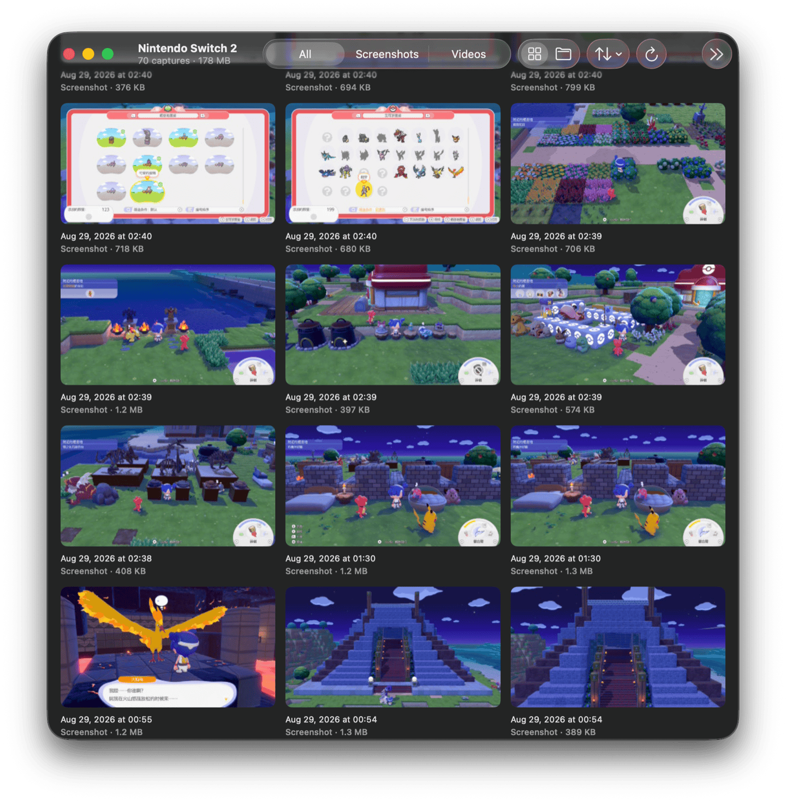

# Tethersnap

[](https://github.com/Luminoid/Tethersnap/releases/latest)
[](#download)
[](LICENSE)

> Export photos and videos from game consoles, cameras, and drives to a Mac. Free, open-source Mac app and CLI.

Tethersnap started as the missing Switch 2 bridge. macOS has no MTP support, and the Android-oriented bridges (OpenMTP, MacDroid, Android File Transfer) fail against the console, which is a plain PTP 1.00 responder with no MTP vendor extension (it implements exactly the ten baseline operations 0x1001-0x100A). Tethersnap is a from-scratch minimal PTP/MTP initiator over `IOUSBHost` that speaks only baseline PIMA 15740, the same subset libmtp uses successfully on Linux, validated end to end against real hardware (firmware 22.5.0): connect, enumeration, thumbnails, and byte-exact exports. That baseline is what every PTP camera speaks too, so Tethersnap lists any still-image-class USB device, and it reads mounted drives and memory cards for the consoles that have no USB mode at all.

<p align="center">
  
</p>

## Download

- **DMG**: get `Tethersnap-<version>.dmg` from the [latest release](https://github.com/Luminoid/Tethersnap/releases/latest), open it, and drag Tethersnap into Applications. The app is Developer ID signed and notarized, so it opens without a Gatekeeper warning.
- **Homebrew**: `brew install --cask luminoid/tap/tethersnap` (from [Luminoid/homebrew-tap](https://github.com/Luminoid/homebrew-tap)).

Requirements: macOS 15 (Sequoia) or later, and a full-data USB-C cable for USB sources. No drivers, no kernel extensions, no MTP stack to install.

How it works, in depth: [Tethersnap: Switch 2 captures on a Mac over plain PTP](https://blog.luminoid.dev/Tethersnap-Switch-2-PTP-on-a-Mac/).

Scaffolded with [Monolith](https://github.com/Luminoid/Monolith).

## Sources

| Source | How it connects | Notes |
|--------|-----------------|-------|
| Nintendo Switch 2 | USB, in Copy to PC mode | Tested on firmware 22.5.0; captures group by game |
| Nintendo Switch | USB, in Copy to PC mode (system software 11.0 or later) | Same protocol, recognized by its USB ID |
| Cameras (DSLR, mirrorless) | USB, in the camera's PTP or MTP mode | Any still-image-class device. RAW files are listed, previewed, and exported untouched. In Image Capture, set the camera's "Connecting this camera opens" to "No application" so macOS does not hold it |
| PS5, PS4 | A USB drive the console wrote to (`PS5/CREATE/…`, `PS4/SHARE/…`) | These consoles have no USB mode for a Mac. Captures group by game; WebM clips export as they are |
| Switch SD card | The card in a reader (`Nintendo/Album/…`) | Groups by date |
| Camera cards | The card in a reader (`DCIM/…`) | Groups by folder (`100CANON`) |
| Steam Deck, anything else | Any mounted drive, or **File › Open Folder…** | Screenshots copied off the Deck, a phone backup, a folder of old exports |

iPhones and iPads expose a PTP interface too and appear in the sidebar; they are untested and never opened automatically.

## Usage

On a Switch: **System Settings → Data Management → Manage Screenshots and Videos → Copy to PC via USB**, connected from the console's **bottom** USB-C port (not the dock) with a full-data cable. On a camera: choose its PTP or MTP USB mode.

CLI:

```bash
swift run tethersnap sources                   # attached USB devices and mounted drives
swift run tethersnap probe                     # device / interface / storage diagnostics
swift run tethersnap list                      # list photos and videos
swift run tethersnap pull --all --out ~/Pictures/Tethersnap
swift run tethersnap pull --all --videos-only  # narrow by kind, like 'list'
swift run tethersnap pull "Game/Game_20260830123456.jpg"   # names as 'list' prints them
swift run tethersnap list --source 2           # a source by index or id from 'sources'
swift run tethersnap list --folder ~/Deck      # any folder
swift run tethersnap fixdates ~/Pictures/Tethersnap --dry-run
```

Ctrl-C cancels a running `pull` or `fixdates` cleanly: the file in progress is removed, the summary still prints, and the command exits 130.

App:

```bash
make run-app             # builds .build/Tethersnap.app and opens it
```

The app lists every attached source in a sidebar (devices, drives, folders), opens the first console or camera on its own, opens a drive when it mounts while nothing else is open, and closes the active source when it is unplugged or ejected (Cancel on the opening screen gives up on a slow device). It shows a thumbnail grid (device thumbnails over PTP, locally generated ones for files, a frame for MP4 and MOV clips) and supports multi-select (click / ⌘-click / shift-click ranges, ⌘A), keyboard navigation (arrows by item and by row, Space/Return or ⌘Y to preview, Escape), sorting, grouping by folder, and a View menu for all three. Preview is Quick Look for items on a drive or folder (videos play inline) and a retryable preview sheet for console items; file-backed items also get Show in Finder. Drag-out to Finder works per item or for a whole selection (dragged as one folder), and per-item / selection / Export All flows can be cancelled. Export destinations are chosen in a standard Open panel, and the layout follows the view: All Items puts everything into that folder, Group by Folder makes one subfolder per game or camera folder (a multi-item drag does the same); the last folder is remembered (⌘⇧E re-exports there, or asks on first run and when that folder is gone; see Settings to inspect or clear it), summaries distinguish saved from already-existing files, capture dates are preserved as file modification dates, and the Mac won't idle-sleep mid-export. A transfer failure or cancel abandons the PTP data phase, so the app throws the session away and reconnects automatically. Closing the window quits the app and releases the device.

### Fix Dates from Filenames

Consoles, phones, and screenshot tools put the shot time in the filename (`20260830123456…`, `Game_20260830123456.jpg`, `Screenshot 2026-08-30 at 12.34.56.png`), and many of those files carry no date inside, so Photos and the Finder sort them by the day they were copied. **File › Fix Dates from Filenames…** (⌘⇧D, the calendar toolbar button, or `tethersnap fixdates` on the command line) picks a folder, preset to the export folder, and stores that timestamp as the capture date: EXIF and XMP for JPEG, PNG, TIFF, and HEIC; the QuickTime creation date for MP4, M4V, and MOV, re-muxed without re-encoding; and the Finder created and modified dates for every matched file. RAW, WebP, GIF, BMP, WebM, AVI, and MTS files get Finder dates only, their bytes are never rewritten. A capture date already embedded in a file (EXIF DateTimeOriginal or DateTimeDigitized, XMP CreateDate) is kept unless you choose **Overwrite existing dates**; a file that carries only a modification time, as the original Switch's JPEGs do, gets a capture date. One limit: the movie-header time inside an MP4 is set by the re-mux itself, so Spotlight's "content created" for a clip may still differ while Photos and the Finder follow the stored tag and file dates.

The UI and error messages are localized in English and Simplified Chinese (following the system language). Strings live in classic `.lproj/Localizable.strings` files because `swift build` copies `.xcstrings` catalogs without compiling them.

## Debugging

The app writes a complete debug trace of every run to `~/Library/Logs/Tethersnap/Tethersnap.log` (the run before it is kept as `Tethersnap.previous.log`), with no setup: just reproduce the problem and grab the file, or use **Help → Reveal Log File in Finder**. Each line carries an ISO-8601 timestamp, the level, and the category, and the first line of a run names the app version, build, and macOS version. If the file cannot be created, the status bar says so and logging continues in the unified log.

Everything also lands in the unified log under subsystem `dev.luminoid.Tethersnap` (categories `usb`, `mtp`, `library`, `volume`, `dates`, `app`). Levels follow `os.Logger`: `notice` and above (sessions, connects, export outcomes, warnings, errors) are saved on disk and can be read after the fact, `info` is kept in memory for a while, and `debug` (hex previews, per-transaction traces) is written only while the CLI's `--verbose` or the app's log file is on. Errors are logged with their domain and code. File paths, filenames, and drive or folder names are private: the unified log shows them as `<private>`, while the log file, which stays on your Mac, keeps them in full.

Read the last hour after the fact:

```bash
/usr/bin/log show --last 1h --info --debug --predicate 'subsystem == "dev.luminoid.Tethersnap"'
```

Or watch live:

```bash
/usr/bin/log stream --level debug --predicate 'subsystem == "dev.luminoid.Tethersnap"'
```

Use the full `/usr/bin/log` path in zsh, whose `log` builtin shadows the command.

The CLI's `--verbose` flag mirrors every line to stderr with a local timestamp and the category (`12:23:12.285 [debug] usb: bulk-in …`), covering USB transfer hex previews and PTP transactions with response codes. It is the fastest way to see where a conversation with a device stops:

```bash
swift run tethersnap probe --verbose
```

The CLI writes `error:` and `warning:` lines to stderr and exits non-zero on failure (including a `pull` whose named files are all missing or that could not save every file, or a `fixdates` with a failed file), so stdout stays clean for scripts; progress lines are printed only on a terminal.

## Targets

| Target | Kind | Notes |
|--------|------|-------|
| TethersnapKit | library | PTP containers/datasets, transaction engine, `IOUSBHost` transport, capture sources (PTP devices, volumes, folders), filename-date fixer |
| `tethersnap` | executable | CLI: `sources` / `probe` / `list` / `pull` / `fixdates` |
| TethersnapApp | executable | SwiftUI Mac app; bundled via `make app` |

## Development

```bash
brew bundle             # install swiftlint + swiftformat
make setup-hooks        # wire pre-commit lint + format
make build
make test               # protocol-layer tests against a scripted mock transport, volume and date-fixer tests on temp files
make check              # strict lint + format gate
make app                # assemble .build/Tethersnap.app (release, ad-hoc signed)
make dist               # Developer ID signed + notarized DMG into dist/
```

The protocol layer is hardware-independent: `MTPSession` runs against any `MTPTransport`, and the tests script exchanges (split headers, coalesced containers, zero-length packets) through a mock. Volume layouts and the date fixer are tested against temporary directory trees and generated images and movies.

### Releasing

`make dist` runs the whole distribution pipeline: hardened-runtime Developer ID signature, notarize the app, staple, wrap in a DMG, notarize and staple the DMG, verify with Gatekeeper. Two one-time setups, and the target prints these instructions itself when either is missing:

1. A **Developer ID Application** certificate in the keychain (create at [developer.apple.com](https://developer.apple.com/account/resources/certificates/list) or via Xcode → Settings → Accounts → Manage Certificates; requires the Account Holder role).
2. Stored notarization credentials: `xcrun notarytool store-credentials tethersnap-notary --apple-id <email> --team-id <team> --password <app-specific password>`.

The result, `dist/Tethersnap-<version>.dmg`, is what a GitHub release attaches.

## License

MIT. © Luminoid. See [LICENSE](LICENSE) and [CHANGELOG](CHANGELOG.md).

Tethersnap is an independent open-source project. It is not affiliated with, endorsed, or sponsored by Nintendo, Sony Interactive Entertainment, or Valve. Nintendo Switch, Nintendo Switch 2, PlayStation, PS5, PS4, and Steam Deck are trademarks of their respective owners, used here only to describe compatibility.

## Acknowledgements

The CLI is built on Apple's [swift-argument-parser](https://github.com/apple/swift-argument-parser) (Apache License 2.0); its license text ships in [THIRD_PARTY_LICENSES.md](THIRD_PARTY_LICENSES.md) and inside the DMG next to the app.

## Related projects

- [Monolith](https://github.com/Luminoid/Monolith): the CLI that scaffolded this project (iOS apps, Swift Packages, Swift CLIs)
- Everything else at [luminoid.dev](https://luminoid.dev)
